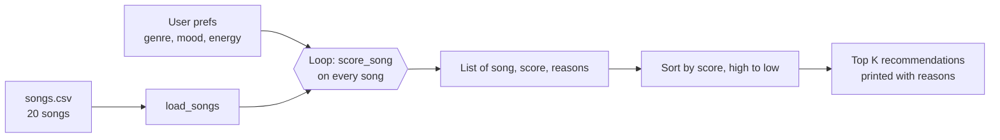

# 🎵 Music Recommender Simulation

## Project Summary

**VibeCheck 1.0** is a small content-based music recommender written in Python. It loads a 20-song catalog from a CSV, scores every song against a user's taste profile (favorite genre, favorite mood, target energy, and optional acoustic preference), and prints the top 5 songs along with the exact reasons each one scored the way it did. It also supports switchable scoring modes (genre-first, mood-first, energy-focused), an optional diversity penalty so one artist can't take over the list, and an ASCII table view. The main point of the project was less about building a "good" recommender and more about seeing how simple weights and a lopsided dataset create bias.

---

## How The System Works

### How real recommenders work (my understanding)

Big platforms like Spotify and YouTube mostly combine two ideas. **Collaborative filtering** looks at behavior across lots of users: if people who listen to the same stuff as me also binge some song I've never heard, it gets pushed to me, even if the system knows nothing about what the song actually sounds like. **Content-based filtering** looks at the songs themselves (genre, tempo, energy, mood, acousticness, etc.) and recommends things that are similar to what I already like. Real systems mix both and feed them a ton of signals: explicit ones like likes, saves, and playlist adds, and implicit ones like skips, replays, how long you listened, and what time of day it is. Skips are honestly one of the most important signals since they tell the system "no" pretty clearly.

My version is a lot smaller. It's purely **content-based**, since I only have one user and a 20-song CSV, so there's no "other users" data to do collaborative filtering with. It prioritizes **genre** first, **mood** second, and then uses **energy** as a "how close is this to what you want" score so the ranking doesn't just come down to yes/no matches.

### Features used

**`Song`** (one row of `data/songs.csv`):
- `genre`, `mood` (categorical)
- `energy` (0.0 to 1.0)
- `acousticness` (0.0 to 1.0)
- also stored but not scored: `tempo_bpm`, `valence`, `danceability`, `title`, `artist`, `id`
- **advanced features (Challenge 1):** `popularity` (0-100), `release_decade`, `mood_tags` (detailed tags like "nostalgic;warm;bittersweet"), `instrumentalness` (0-1), `liveness` (0-1)

**`UserProfile`** (the taste profile):
- `favorite_genre` / `genre`
- `favorite_mood` / `mood`
- `target_energy` / `energy` (a number from 0 to 1, not "high" or "low")
- `likes_acoustic` (True/False, optional)
- optional advanced prefs: `target_popularity`, `favorite_decade`, `mood_tags` (list), `wants_instrumental`, `likes_live`

Example profile I designed around:

```python
user_prefs = {"genre": "pop", "mood": "happy", "energy": 0.8, "likes_acoustic": False}
```

I had the AI critique this profile and the main point was that genre + mood + one energy number is enough to separate "intense rock" (energy ~0.9, low acousticness) from "chill lofi" (energy ~0.4, high acousticness), but it is pretty narrow. It can't express things like "I like pop OR indie pop," and it can't say "I want low energy but not acoustic." That's a tradeoff I'm accepting for a simulation.

### Algorithm Recipe (the scoring rule)

Each song gets judged on its own against the user's profile:

| Rule | Points |
|---|---|
| Genre matches `favorite_genre` | **+2.0** |
| Mood matches `favorite_mood` | **+1.0** |
| Energy closeness | **+1.5 × (1 − \|song.energy − target_energy\|)** |
| Acoustic preference (if the user set it) | **+0.5 × acousticness** if they like acoustic, otherwise **+0.5 × (1 − acousticness)** |

**Advanced features (only scored if the user sets them):**

| Rule | Points |
|---|---|
| Popularity closeness | **+0.5 × (1 − gap/100)** |
| Release decade | **+0.5** exact match, **+0.25** if one decade off |
| Detailed mood tags | **+0.3 per overlapping tag**, capped at +0.9 |
| Instrumental preference | **+0.5 × instrumentalness** (or 1 − it) |
| Live preference | **+0.3 × liveness** (or 1 − it) |

So with just the core prefs a perfect song maxes out at **5.0** (7.7 if every advanced pref is set). The energy part is the important design choice: it rewards songs that are *close* to the target instead of just rewarding "more energy." A song at 0.80 energy for a 0.80 user gets the full 1.5, while a song at 0.30 only gets 0.75. Genre is worth double mood because, in my experience, genre is the bigger dealbreaker (a sad country song and a sad metal song are not interchangeable), but mood still matters enough to break ties.

### Ranking rule

The scoring rule only tells you how good **one** song is. The ranking rule is what turns that into a recommendation: score every song in the catalog, sort them highest to lowest, and return the top `k`. You need both because a score on its own means nothing until you compare it to everything else, and ranking needs some number to sort by.

### Data flow



### Biases I expect going in

- **Genre over-prioritization.** Since genre is worth 2 points, a pop song with the wrong mood will usually beat a perfect-mood song from a different genre. Someone who wants "happy" music might never see a great happy indie pop song just because it's not labeled "pop."
- **Exact string matching.** "pop" and "indie pop" count as completely different genres, so related genres get zero credit.
- **Catalog imbalance.** Some genres (pop, lofi) have multiple songs while most only have one, so users with niche taste will run out of genre matches fast.

---

## Getting Started

### Setup

1. Create a virtual environment (optional but recommended):

   ```bash
   python -m venv .venv
   source .venv/bin/activate      # Mac or Linux
   .venv\Scripts\activate         # Windows
   ```

2. Install dependencies

```bash
pip install -r requirements.txt
```

3. Run the app:

```bash
python -m src.main                          # all 9 test profiles, balanced weights
python -m src.main --profile "Chill Lofi"   # just one profile
python -m src.main --mode energy_focused    # other modes: genre_first, mood_first
python -m src.main --diverse --table        # diversity penalty + ASCII table
```

### Running Tests

Run the starter tests with:

```bash
pytest
```

There are 7 tests in `tests/test_recommender.py` covering the `Recommender` class, CSV loading, scoring, ranking order, and the diversity penalty.

---

## Sample Recommendation Output

Output of `python -m src.main --profile "Default Pop/Happy"` (the default "pop / happy / energy 0.8" profile):

```
Loaded songs: 20

================================================================
Profile: Default Pop/Happy   (mode: balanced)
Prefs:   {'genre': 'pop', 'mood': 'happy', 'energy': 0.8}
================================================================
1. Sunrise City by Neon Echo  [pop / happy]
   Score: 4.47
     - genre match (+2.0)
     - mood match (+1.0)
     - energy 0.82 vs target 0.80 (+1.47)
2. Gym Hero by Max Pulse  [pop / intense]
   Score: 3.31
     - genre match (+2.0)
     - energy 0.93 vs target 0.80 (+1.30)
3. Heartbreak Neon by Neon Echo  [pop / sad]
   Score: 3.20
     - genre match (+2.0)
     - energy 0.60 vs target 0.80 (+1.20)
4. Rooftop Lights by Indigo Parade  [indie pop / happy]
   Score: 2.44
     - mood match (+1.0)
     - energy 0.76 vs target 0.80 (+1.44)
5. Concrete Crown by Lyric Vault  [hip hop / confident]
   Score: 1.47
     - energy 0.78 vs target 0.80 (+1.47)
```

These match what I'd expect. "Sunrise City" is the only song that hits pop, happy, *and* the right energy, so it wins by a lot. "Gym Hero" and "Heartbreak Neon" make the top 3 just from the genre bonus, even though their moods (intense and sad) are wrong. "Rooftop Lights" is honestly a better fit vibe-wise than "Heartbreak Neon" for a happy pop fan, but it's labeled "indie pop," so it misses the +2.0. That's the genre bias I predicted showing up immediately.

Same profile with `--diverse --table` (diversity penalty + table view). Heartbreak Neon drops from #3 to #4 because Neon Echo and pop are both already in the list:

```
Loaded songs: 20

Profile: Default Pop/Happy   (mode: balanced + diversity)
Prefs:   {'genre': 'pop', 'mood': 'happy', 'energy': 0.8}
+-----+------------------------+------------------+------------------------+--------+------------------------------------------------+
| #   | Title                  | Artist           | Genre / Mood           | Score  | Reasons                                        |
+=====+========================+==================+========================+========+================================================+
| 1   | Sunrise City           | Neon Echo        | pop / happy            | 4.47   | genre match (+2.0)                             |
|     |                        |                  |                        |        | mood match (+1.0)                              |
|     |                        |                  |                        |        | energy 0.82 vs target 0.80 (+1.47)             |
+-----+------------------------+------------------+------------------------+--------+------------------------------------------------+
| 2   | Gym Hero               | Max Pulse        | pop / intense          | 2.81   | genre match (+2.0)                             |
|     |                        |                  |                        |        | energy 0.93 vs target 0.80 (+1.30)             |
|     |                        |                  |                        |        | diversity: genre already listed (-0.5)         |
+-----+------------------------+------------------+------------------------+--------+------------------------------------------------+
| 3   | Rooftop Lights         | Indigo Parade    | indie pop / happy      | 2.44   | mood match (+1.0)                              |
|     |                        |                  |                        |        | energy 0.76 vs target 0.80 (+1.44)             |
+-----+------------------------+------------------+------------------------+--------+------------------------------------------------+
| 4   | Heartbreak Neon        | Neon Echo        | pop / sad              | 1.70   | genre match (+2.0)                             |
|     |                        |                  |                        |        | energy 0.60 vs target 0.80 (+1.20)             |
|     |                        |                  |                        |        | diversity: artist already listed (-1.0)        |
|     |                        |                  |                        |        | diversity: genre already listed (-0.5)         |
+-----+------------------------+------------------+------------------------+--------+------------------------------------------------+
| 5   | Concrete Crown         | Lyric Vault      | hip hop / confident    | 1.47   | energy 0.78 vs target 0.80 (+1.47)             |
+-----+------------------------+------------------+------------------------+--------+------------------------------------------------+
```

Full output for all 7 profiles (plus the weight experiment) is in the Evaluation section of [model_card.md](model_card.md).

---

## Experiments You Tried

- **Weight shift (energy x2, genre x0.5).** I added an `energy_focused` mode (genre 1.0, mood 1.0, energy 3.0). For the happy pop user, "Rooftop Lights" jumped from #4 to #2, passing two pop songs with the wrong mood. I think that's more accurate, since it's actually a happy, upbeat song. The downside is that high-energy songs like "Gym Hero" and "Pulse Reactor" got even stickier for anyone who wants energetic music.
- **Adversarial profiles.** I tested a "Sad but Hyped" user (folk, sad, energy 0.9), a "Ghost Genre" user (k-pop, which isn't in the catalog), and an "Acoustic Headbanger" (metal, angry, likes acoustic). The sad one got a slow folk song at #1 because labels outweighed the energy mismatch. The k-pop one fell back to reasonable happy songs. The acoustic preference was basically ignored for the headbanger because there are no loud acoustic songs.
- **Diversity penalty.** With `--diverse`, a repeat artist loses 1.0 and a repeat genre loses 0.5. For Chill Lofi, the second LoRoom song dropped from #3 to #4, letting an ambient track in. It's a soft penalty, so repeat artists can still show up if they're a strong enough match.
- **Advanced features (Challenge 1).** I added 5 new columns (popularity, release decade, detailed mood tags, instrumentalness, liveness) and two profiles that use them. The tags turned out to be the most interesting part: they gave cross-genre songs a way in. For the "Deep Focus Instrumental" user, a classical piece ("Moonlit Sonata No. 2") made the top 5 because it's calm, instrumental, and matches the popularity target exactly, even with no genre or mood match. For the "90s Nostalgia Hunter," a 90s jazz song tagged "warm; nostalgic" jumped to #2. The original 7 profiles produce exactly the same output as before, since the new rules only apply when a profile asks for them.
- **Different user types.** Users at the extremes (chill lofi, intense rock) got very clean lists. Users whose genre only has one song got one good match and then a list sorted mostly by energy.

---

## Limitations and Risks

- **Tiny catalog.** 20 songs, and most genres only have 1, so niche users run out of matches immediately.
- **Genre dominates.** A +2.0 genre bonus means a wrong-mood pop song usually beats a perfect-mood song from another genre.
- **Exact string matching.** "indie pop" gets zero credit for a "pop" fan.
- **Catalog imbalance = filter bubble.** Pop and lofi have 3 songs each, so those users get more varied, higher-scoring lists than everyone else.
- **No context or history.** It doesn't know lyrics, language, time of day, what you skipped, or what you've already heard.
- **"Gym Hero" problem.** One high-energy pop song shows up in the top 5 for 5 out of 7 profiles, because energy closeness gives points to everyone and the catalog is small.

More detail is in the [model card](model_card.md).

---

## Reflection

Read the full write-up in the [**Model Card**](model_card.md).

The biggest thing I learned is that a recommender is really just two steps: a scoring rule that judges one song at a time, and a ranking rule that sorts all the scores. Everything that makes it feel "smart" comes from which features you score and how much each one is worth. My version is literally a weighted sum, and the Chill Lofi results still looked like a playlist I'd actually listen to. That was kind of eye-opening, because it means a recommendation can feel personal without the system understanding music at all.

The flip side is that bias shows up really easily, and it doesn't look like bias from the inside. I picked +2.0 for genre because it felt reasonable, but combined with a catalog where pop has 3 songs and metal has 1, pop fans end up with better lists than metal fans, and a sad pop song beats a happy indie pop song for a happy pop user. Nobody "decided" to favor pop, it just fell out of the weights and the data. At Spotify's scale, with millions of songs and real money attached to exposure, that same kind of quiet imbalance could decide which artists get heard, which is why things like model cards and diversity penalties actually matter.
