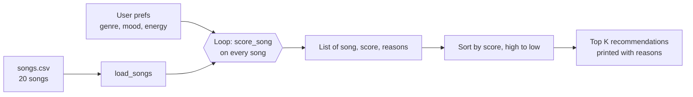

# 🎵 Music Recommender Simulation

## Project Summary

In this project you will build and explain a small music recommender system.

Your goal is to:

- Represent songs and a user "taste profile" as data
- Design a scoring rule that turns that data into recommendations
- Evaluate what your system gets right and wrong
- Reflect on how this mirrors real world AI recommenders

Replace this paragraph with your own summary of what your version does.

---

## How The System Works

### How real recommenders work (my understanding)

Big platforms like Spotify and YouTube mostly combine two ideas. **Collaborative filtering** looks at behavior across lots of users: if people who listen to the same stuff as me also binge some song I've never heard, it gets pushed to me, even if the system knows nothing about what the song actually sounds like. **Content-based filtering** looks at the songs themselves (genre, tempo, energy, mood, acousticness, etc.) and recommends things that are similar to what I already like. Real systems mix both and feed them a ton of signals: explicit ones like likes, saves, and playlist adds, and implicit ones like skips, replays, how long you listened, and what time of day it is. Skips are honestly one of the most important signals since they tell the system "no" pretty clearly.

My version is a lot smaller. It's purely **content-based**, since I only have one user and a 20-song CSV, so there's no "other users" data to do collaborative filtering with. It prioritizes **genre** first, **mood** second, and then uses **energy** as a "how close is this to what you want" score so the ranking doesn't just come down to yes/no matches.

### Features used

**`Song`** (one row of `data/songs.csv`):
- `genre`, `mood` (categorical)
- `energy` (0.0 to 1.0)
- `acousticness` (0.0 to 1.0)
- also stored but not scored: `tempo_bpm`, `valence`, `danceability`, `title`, `artist`, `id`

**`UserProfile`** (the taste profile):
- `favorite_genre` / `genre`
- `favorite_mood` / `mood`
- `target_energy` / `energy` (a number from 0 to 1, not "high" or "low")
- `likes_acoustic` (True/False, optional)

Example profile I designed around:

```python
user_prefs = {"genre": "pop", "mood": "happy", "energy": 0.8, "likes_acoustic": False}
```

I had the AI critique this profile and the main point was that genre + mood + one energy number is enough to separate "intense rock" (energy ~0.9, low acousticness) from "chill lofi" (energy ~0.4, high acousticness), but it is pretty narrow. It can't express things like "I like pop OR indie pop," and it can't say "I want low energy but not acoustic." That's a tradeoff I'm accepting for a simulation.

### Algorithm Recipe (the scoring rule)

Each song gets judged on its own against the user's profile:

| Rule | Points |
|---|---|
| Genre matches `favorite_genre` | **+2.0** |
| Mood matches `favorite_mood` | **+1.0** |
| Energy closeness | **+1.5 × (1 − \|song.energy − target_energy\|)** |
| Acoustic preference (if the user set it) | **+0.5 × acousticness** if they like acoustic, otherwise **+0.5 × (1 − acousticness)** |

So a perfect song maxes out at **5.0**. The energy part is the important design choice: it rewards songs that are *close* to the target instead of just rewarding "more energy." A song at 0.80 energy for a 0.80 user gets the full 1.5, while a song at 0.30 only gets 0.75. Genre is worth double mood because, in my experience, genre is the bigger dealbreaker (a sad country song and a sad metal song are not interchangeable), but mood still matters enough to break ties.

### Ranking rule

The scoring rule only tells you how good **one** song is. The ranking rule is what turns that into a recommendation: score every song in the catalog, sort them highest to lowest, and return the top `k`. You need both because a score on its own means nothing until you compare it to everything else, and ranking needs some number to sort by.

### Data flow



### Biases I expect going in

- **Genre over-prioritization.** Since genre is worth 2 points, a pop song with the wrong mood will usually beat a perfect-mood song from a different genre. Someone who wants "happy" music might never see a great happy indie pop song just because it's not labeled "pop."
- **Exact string matching.** "pop" and "indie pop" count as completely different genres, so related genres get zero credit.
- **Catalog imbalance.** Some genres (pop, lofi) have multiple songs while most only have one, so users with niche taste will run out of genre matches fast.

---

## Getting Started

### Setup

1. Create a virtual environment (optional but recommended):

   ```bash
   python -m venv .venv
   source .venv/bin/activate      # Mac or Linux
   .venv\Scripts\activate         # Windows

2. Install dependencies

```bash
pip install -r requirements.txt
```

3. Run the app:

```bash
python -m src.main
```

### Running Tests

Run the starter tests with:

```bash
pytest
```

You can add more tests in `tests/test_recommender.py`.

---

## Sample Recommendation Output

Paste a sample of your recommender's output here as a text block so a reader can see what it produces:

```
# e.g.:
# User profile: genre=indie, mood=chill, energy=low
# Recommendations:
#   1. ...
#   2. ...
#   3. ...
```

**Screenshot or video** *(optional)*: <!-- Insert a screenshot or demo video link here -->

---

## Experiments You Tried

Use this section to document the experiments you ran. For example:

- What happened when you changed the weight on genre from 2.0 to 0.5
- What happened when you added tempo or valence to the score
- How did your system behave for different types of users

---

## Limitations and Risks

Summarize some limitations of your recommender.

Examples:

- It only works on a tiny catalog
- It does not understand lyrics or language
- It might over favor one genre or mood

You will go deeper on this in your model card.

---

## Reflection

Read and complete `model_card.md`:

[**Model Card**](model_card.md)

Write 1 to 2 paragraphs here about what you learned:

- about how recommenders turn data into predictions
- about where bias or unfairness could show up in systems like this


